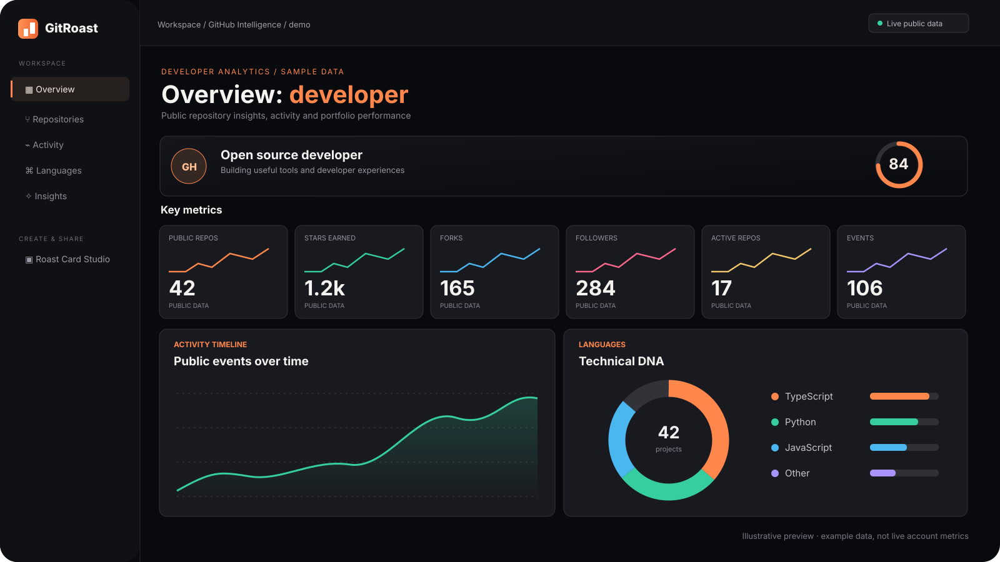

<div align="center">



# GitRoast Intelligence

**Your GitHub, decoded.** A refined, no-login analytics dashboard for any public GitHub profile.

[Explore the dashboard](./index.html) · [Open the Roast Card Studio](./studio.html)

</div>

---

## An actual analytics workspace, not a static landing page

GitRoast Intelligence turns **public GitHub profile, repository and event data** into a clear, interactive dashboard. Inspired by professional product analytics, built specifically for developer portfolios.

- **Profile overview:** public avatar, bio, location/company when provided, join year, followers and a clearly marked *heuristic* portfolio signal.
- **Live KPIs:** public repositories in the downloaded sample, total stars, received forks, followers, recently active repositories and observed public events.
- **Activity analytics:** recent public events plotted by day with 7-, 30- and 90-day windows. Event stream labeled by type and repository.
- **Language distribution:** interactive-style donut and legend based on the **primary language of each original public repository**, not lines of code.
- **Repository intelligence:** searchable, sortable, paginated table with metadata, stars, forks, last push and archived/stale signals.
- **Engagement ranking:** original repositories ranked by their stars.
- **Portfolio hygiene:** clear visual signals for descriptions, maintenance, originality and archived status.
- **Insights:** contextual, local heuristics and one intentionally playful GitRoast verdict.
- **Export:** download repo analytics as a CSV, or open the retained **Roast Card Studio** for customized 1600×900 SVG and PNG cards.
- **Share:** permalinks using `?u=github-username`.

## Design

Dark professional dashboard, persistent sidebar navigation, modular cards, vector data visualizations, real empty states, compact typography and responsive layouts. No charting framework required.

## How to use

Open `index.html` in a browser, or start a local server:

```bash
npm install
npm run dev
```

Enter any valid public GitHub username to inspect that account. The site initially loads the author's own public profile.

The existing share-card experience is preserved as `studio.html`. If you open the dashboard with `?u=username`, links to the Studio carry the same username.

## Honest data limitations

- Everything is public data fetched from GitHub's REST API, **not private profile information**.
- GitHub's unauthenticated API rate limits apply, and individual requests can fail.
- Repository pagination is capped at **500 repositories**. The dashboard shows how many public repositories were actually downloaded; metrics may be partial.
- Recent public events are subject to GitHub's event history and pagination limits. These **are not all contributions**, and the activity chart never claims to show the contribution calendar.
- The language chart counts the **primary language of repositories**, not actual byte share or lines of code.
- The *portfolio signal* and roasts are playful heuristics, **not measurements of engineering competence**.
- Revenue, unique visitors, conversion, personal financial data and private repositories **are not displayed**, because GitHub's public profile API does not provide those figures.
- The README artwork is an **illustration with sample data**, not the author's actual account metrics.

## Privacy, cost and stack

Vanilla HTML / CSS / JavaScript · GitHub REST API · SVG charts · no database · no telemetry · no backend · no paid API. Requests go directly from the visitor's browser to GitHub. No GitHub login or access token is required.

## Tests

`node scripts/verify.mjs` checks syntax, required controls, links, value-safe markup, pagination and the retained Studio's theme/SVG logic. GitHub Actions runs verification on every push and pull request.

## License

MIT — open source and free to run.