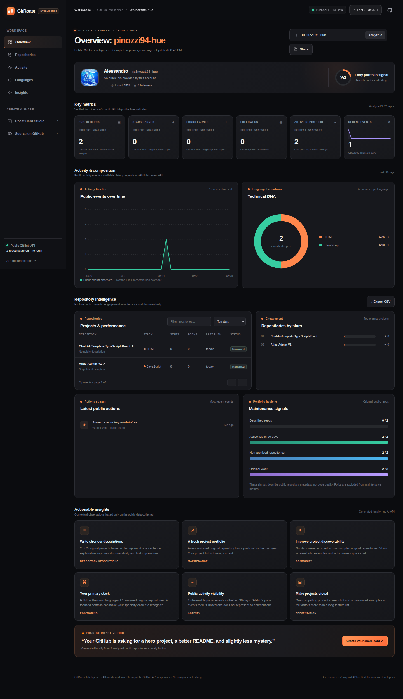

# GitRoast Intelligence

**A real analytics dashboard for public GitHub profiles. No fabricated traffic, earnings, trendlines or user metrics.**

GitRoast turns GitHub public profile, repository and event API responses into a responsive developer dashboard. The original card creator is preserved as [Card Studio](./studio.html), with themed SVG/PNG exports.

**Status:** public source · automated tests · no paid API · GitHub Pages hosting not enabled.

## What actually works

- **Public profile:** avatar, username, display name, bio, publicly provided company/location, join year, follower count.
- **Current snapshot KPIs:** sampled public repositories, stars and forks on original repos, followers, recently pushed repos, observed events.
- **Public event timeline:** 7/30/90-day plot of the actual available event records. Not GitHub's complete contribution graph.
- **Primary language distribution:** counts of original repositories by their main language, not byte shares.
- **Repository explorer:** search, sorting, pagination, archived/fork/stale labels, stars, forks, latest push.
- **Health & insights:** documented rule-based portfolio observations and a playful roast, not a skill score.
- **Exports:** actual sampled repo data to CSV and the preserved Studio for SVG/PNG report cards.

## Screenshots — only from the real app

These images were **captured by Chromium running the actual committed application**. The dashboard loaded the real public profile `pinozzi94-hue` using genuine GitHub REST API responses. No sample metrics, stock images or generated dashboard art.



[View actual mobile screenshot](./assets/dashboard-mobile.png) · [Inspect screenshot timestamp, KPI values and HTTP provenance](./assets/screenshot-source.json)

**Capture:** 28 October 2026, 20:41 UTC. **Coverage:** 2 of 2 public repositories. These are point-in-time results; today's counts can differ. The [capture workflow](./.github/workflows/capture.yml) runs the site in Chromium and regenerates both screenshots from real GitHub data after changes to the app.

## Run locally

Open a terminal from the repository root:

```bash
python3 -m http.server 4173
```

Visit http://localhost:4173. Or run `npm install && npm run dev` with Node.js. The page initially requests the public profile `pinozzi94-hue`; search for any public GitHub username. Permalinks use `?u=username`.

## Where the data comes from

| Metric | Source | Important limitation |
| --- | --- | --- |
| Profile/followers | `GET /users/{username}` | Public data only |
| Repositories, stars, forks, statuses | `GET /users/{username}/repos` | Up to 500 downloaded repos; partial coverage disclosed |
| Language donut | Primary `language` on original public repos | Not lines of code |
| Activity timeline | `GET /users/{username}/events/public` | Visible public events only; not all contributions |
| Signal and roast | Local rule-based heuristics | Not a professional assessment |

**GitHub public profile data does not contain** visitor counts, revenue, conversion rates, historic star/follower growth, complete contribution histories, or private repositories. The dashboard does not fabricate them. Static KPIs are marked as current snapshots.

For all details, see **[Data sources, limitations & screenshot provenance](./docs/DATA_SOURCES.md)**.

## Test and verification

```bash
npm test
```

or `node scripts/verify.mjs`. The [quality workflow](./.github/workflows/quality.yml) checks syntax, navigation, data metrics, SVG/PNG export paths and public API usage on every push.

## Privacy, costs and availability

The browser calls the GitHub API directly; there is no account sign-in, database, telemetry or paid AI service. The public API rate limits still apply. The screenshot capture uses a short-lived GitHub Actions token **in CI only** to retrieve unmodified public responses; that token is not embedded in the site.

**There is not yet a verified hosted live demo.** A public GitHub repository is not itself a deployed website. GitHub Pages is not enabled. The existing repository slug remains `Chat-AI-Template-TypeScript-React` because the available GitHub connector does not expose the rename operation.

## License

[MIT](./LICENSE).
