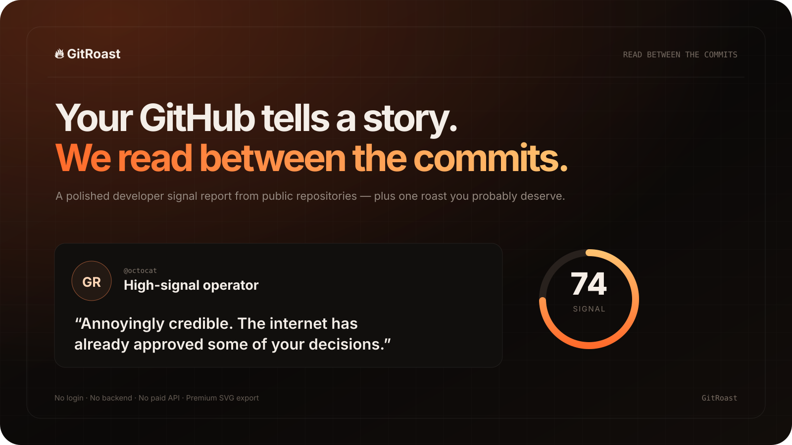

# GitRoast

### Your GitHub tells a story. We read between the commits.

A polished, shareable developer signal report built from public GitHub data — repository health, language signature, standout work, and one tasteful roast.

**No login · No backend · No tracking · No paid AI API**

---

## What it does

Enter any public GitHub username. GitRoast reads public profile and repository metadata directly from GitHub, analyzes it in the browser, and turns it into a visual report.

The report includes:

- **Developer signal score** based on public repository signals
- **Repository health** for documentation, freshness, originality and maintenance
- **Language signature** across original public repositories
- **Repository spotlight** for projects with the strongest activity/star signal
- **Deterministic roast engine** — playful, repeatable, and not AI-generated
- **Premium 1600×900 SVG export** designed for portfolios and social sharing
- **Shareable permalinks** using <code>?u=username</code>

## Why GitRoast

Most GitHub profile analyzers look like dashboards. GitRoast is designed like a product.

The goal is to make public developer data **fast to understand, visually memorable and worth sharing**, while staying completely free to run.

## Zero-cost architecture

GitRoast is intentionally tiny:

- Vanilla HTML, CSS and JavaScript
- GitHub public REST API
- No server
- No database
- No auth
- No analytics
- No API key
- No paid infrastructure

Everything happens in the visitor's browser.

## Run locally

You can open <code>index.html</code> directly or use any static file server.

With Node installed:

    npm install
    npm run dev

## Privacy

GitRoast only requests public GitHub information for the username entered by the visitor. Nothing is stored by this project.

GitHub's unauthenticated public API rate limits still apply.

## A note about the score

The score is a playful product metric derived from public repository signals. It is **not** an assessment of engineering ability, employability, seniority or professional value.

## License

MIT

---

Built to be shared. Designed to cost nothing.

